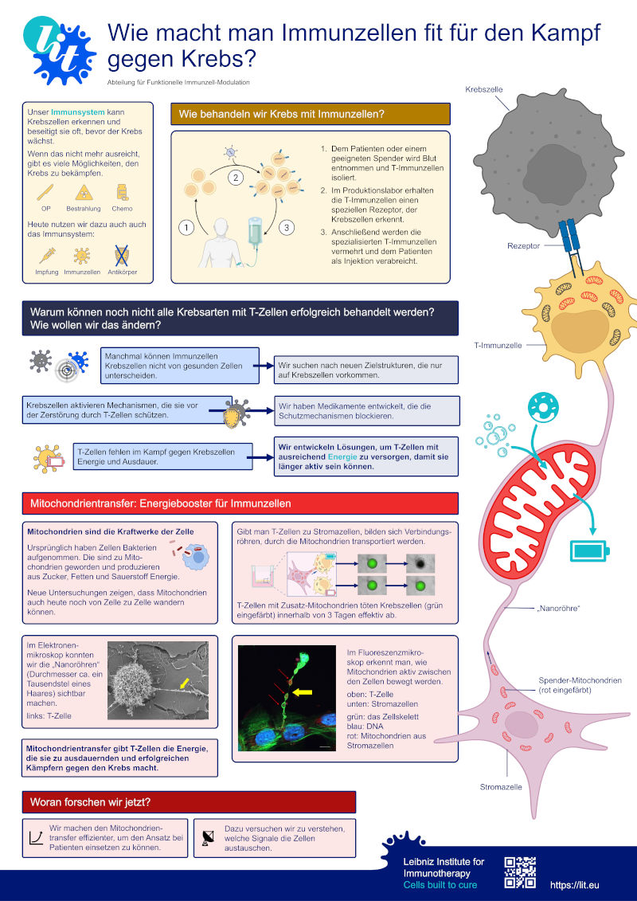

How can we make immune cells better at fighting cancer? At the [International LIT Symposium 2026](https://lit-symposium.org/) dedicated to *Synthetic Immunology / Synthetic Biology*, I presented a poster addressing this question in an accessible way for a general audience.
The public engagement event brought together members of the public with internationally renowned immunologists, including **Marcela Maus**, **Hinrich Abken**, and Nobel laureate **Shimon Sakaguchi**.

Under the title *"Wie macht man Immunzellen fit für den Kampf gegen Krebs?"*, the poster introduces the potential of engineering T cells to improve their ability to recognize and eliminate cancer cells — and to remain functional over time.

  <a href="/files/lit-symposium-2026-poster.pdf" target="_blank">
    View or download the poster (PDF, German)
  </a>

