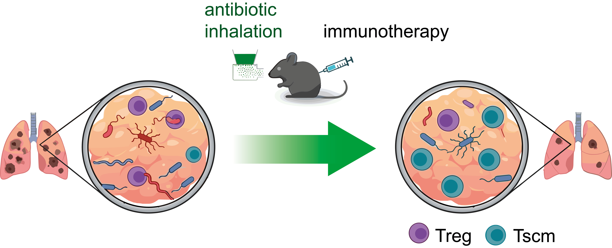

## The Friendly Face of Antibiotics in Checkpoint Therapy

New paper in <i>Cancer Immunology Research</i>: Bacteria that thrive in lungs bearing tumor metastases support regulatory T cell (Treg) accumulation and function and clearing them with local antibiotics, restored the antitumor response: more stem-like T cells, greater T cell cytotoxicity, and, in combination with anti-PD-1 treatment, far more complete tumor remissions in mice. Some human lung cancer samples (~35%) contained the same bacterial signatures, which were associated with increased Treg infiltration, stirring up hopes that a similar regimen may overcome therapy resistance in those patients.
The project started in Milan, where colleagues found that lung tumors carry their own bacterial communities and that inhaled antibiotics can boost checkpoint blockade. The finding that Tregs are key intermediaries established a direct connection to [my earlier work](/publications/2017-10-17_IKKb-CellRep) on functionally disabling Tregs to improve CD8+ T cell responses. We thus joined forces to illuminate how restoring the local microbiome ultimately translates into stronger antitumor immunity.
Bringing together microbiology and T cell biology across two countries wasn't always smooth - samples traveling from Milan to Regensburg, a peer-review process that certainly tested our patience - but the results held up. Clinical studies are next, and I hope this local, targeted approach can eventually help patients respond better to immunotherapy.  
📄 Press release: [link]() 
📄 Paper: [Le Noci*, Heuser-Loy*, *et al.* Antibiotic aerosol resets microbial dysregulation in metastatic lungs, potentiating anti-PD-1-driven T memory stem cell–associated tumor regressions](https://doi.org/10.1158/2326-6066.CIR-26-0438)
